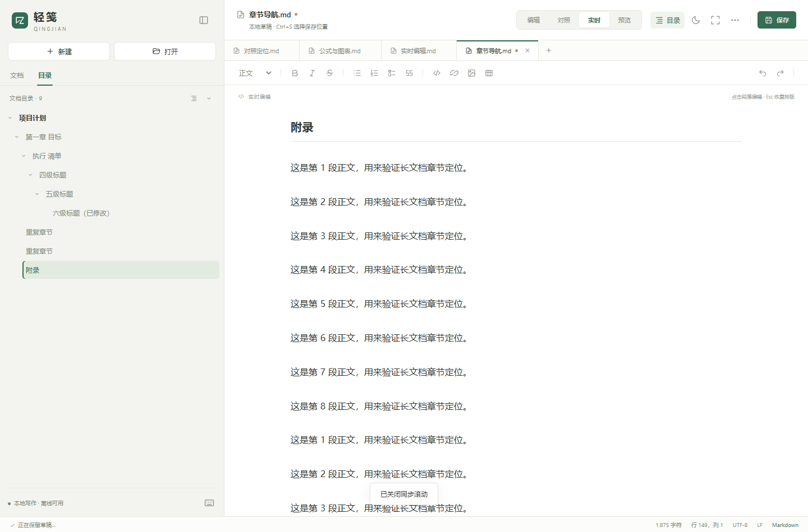
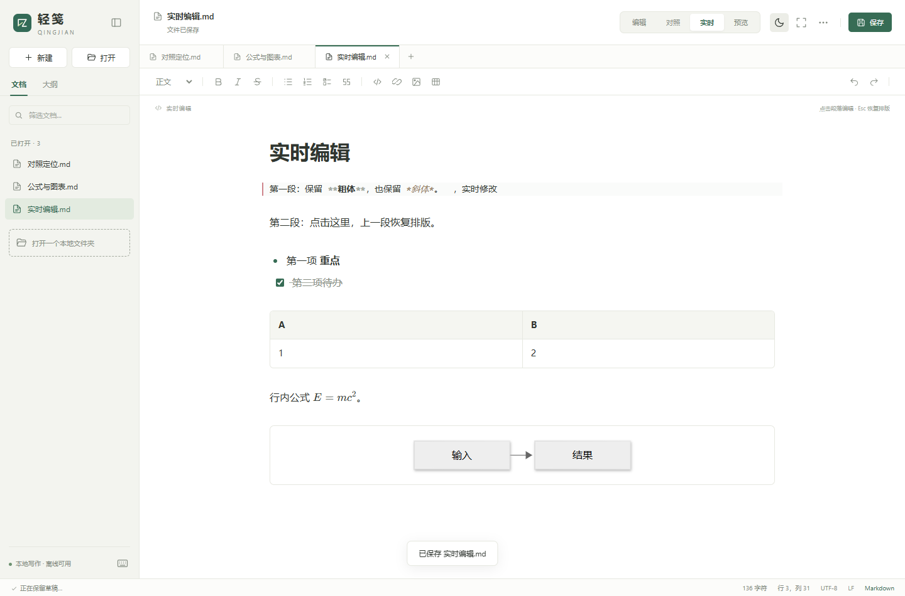

# 轻笺

一个离线的 Windows Markdown 编辑器，使用系统 WebView2、原生 WinForms 外壳和 CodeMirror 6。界面无需联网加载，发布包不包含 Node.js 或浏览器内核。当前版本 v0.4.2，完整程序文件约 7.8 MiB，不含系统运行时和个人缓存。

从 [Releases](https://github.com/ly2u/qingjian/releases/latest) 下载 Windows x64 压缩包，解压后双击 `轻笺.exe`。请保留整个文件夹。

支持编辑、对照、实时、预览四种视图，多文档标签、同步滚动、双向定位高亮、自动保存、外部修改自动刷新、文件夹列表、文档大纲、查找替换、常用格式工具、任务勾选、主题切换、草稿恢复、图片插入与 HTML / PDF 导出。详见 [使用说明](使用说明.txt)。


## 目录与大纲

点击顶部“目录”，或按 `Ctrl+Shift+O` 显示、收起左侧目录；也可在左侧“文档 / 目录”之间切换。程序会记住上次选择。

拖动左侧栏右边界可自由调整目录和文件列表的宽度，松开后自动记住；双击边界恢复默认宽度。目录以缩进表示层级，长标题保留省略显示与悬停完整标题，不再额外显示 H1、H2 等标记。

目录由 Markdown 的 `#` 至 `######` 标题自动生成，支持点击跳转、逐级折叠、全部展开和全部收起。编辑标题或读取到外部修改后，目录自动更新；当前编辑或阅读的章节会高亮。编辑、对照、实时、预览四种视图均可使用，对照视图关闭同步滚动后，点击目录仍会定位两侧。



## 实时编辑

点击顶部“实时”或按 `Ctrl+4` 进入单栏实时编辑模式。未编辑的内容显示排版效果，点击某个段落后展开其 Markdown 源码；移到其他段落后，前一段恢复排版。也可以按 `Esc` 收起当前源码。

普通文字按段落切换，列表按条目切换；表格、代码、独立公式和 Mermaid 按整块展开。公式和图表沿用离线渲染，任务框可以直接勾选。`Ctrl+单击` 链接可跳转。

实时模式与其他视图共用同一份 Markdown，支持原有撤销重做、查找替换、格式快捷键与草稿恢复，保存时仍为 `.md` 文本。



## 公式和图表

公式由 KaTeX 渲染，支持 `$…$` 行内公式、`$$…$$` 独立公式，以及 `\(…\)`、`\[…\]`。Mermaid 使用标记为 `mermaid` 的代码块，支持流程图、时序图、甘特图、类图等。两项功能均离线可用，仅在文档包含相应内容时加载。

[公式与图表示例](examples/公式与图表.md) 可直接在轻笺中打开。HTML 导出会嵌入公式字体与已渲染的图表；预览中的语法错误会保留原文并显示提示。

对照模式中，点击左侧会高亮右侧对应段落；点击右侧会定位并高亮左侧源码。表格按行、列表按条目对应，公式和图表按整块对应。

## 自动保存与多端同步

已经打开或首次保存到磁盘的文档，在输入停顿约 700 毫秒后自动写回原文件，持续输入时约每 2 秒补存一次。切换文档、窗口失去焦点或退出前也会尝试补存。未命名文档先按 `Ctrl+S` 选择保存位置，之后自动保存；`Ctrl+S` 仍可立即保存。恢复草稿继续单独保留。

源文件被其他编辑器或同步软件修改后，已打开的标签会自动读取新内容并更新预览，后台标签也会更新。启动时先检查磁盘版本，避免旧会话覆盖新文件。文件监听之外，每 3 秒检查一次文件元数据，并在窗口重新激活时复查。

本地与外部同时有修改时，自动保存会暂停，界面提供两份源码对照。可选择使用本地版本或外部版本；使用外部版本时，本地编辑会保留为另一个“本地冲突副本”草稿标签。文件被移走或删除时保留当前内容，可重新创建或另存为；暂时无法访问的文件会自动重试。

把 Markdown 文件放在 OneDrive、Syncthing 等工具管理的同步文件夹中，即可由这些工具传输文件，轻笺负责本机的自动读写与冲突提示。轻笺本身不提供账号、云存储或同步传输服务。

## Windows 文件关联

首次使用时，在程序的“更多选项 → Windows 文件关联”中选择“注册到打开方式”，再点“选择默认应用”。也可以双击程序目录中的 `注册到打开方式.cmd`。

更新版本时，关闭旧窗口并打开新版，直接点“替换旧版注册”；也可双击新版目录中的 `注册到打开方式.cmd`。程序会自动查找并更新旧版的打开命令、图标和卸载入口，无需先卸载旧注册。原来选择轻笺的默认打开方式可沿用，其他应用的默认选择不变。即使旧版可执行文件改过名字，也会保留并更新其兼容入口。

注册对当前用户生效，无需管理员权限。支持 `.md`、`.markdown`、`.mdown`，不修改其他编辑器的默认选择。已经打开轻笺时，再双击 Markdown 文件会交给现有窗口打开。

选择“移除系统注册”，或双击 `移除系统注册.cmd`，可清除轻笺创建的注册项。Windows 的“已安装的应用”中也有“轻笺（便携版系统注册）”移除入口。程序文件和个人数据会保留；卸载当前版本时，先移除注册，再删除程序文件夹。若轻笺曾是默认应用，移除后需重新选择打开方式。移动程序目录后直接更新注册即可；更新完成后可删除旧程序目录。

## 开发与构建

在 Windows 10/11 x64 上安装 Node.js 22 或更高版本。原生外壳使用系统 .NET Framework C# 编译器，不需要安装 Rust 或 .NET SDK。

```powershell
npm ci
npm test
npm run build
npm run test:browser
```

首次构建会从微软 NuGet 下载 WebView2 SDK。后续构建使用 `.build/webview2` 缓存。运行环境为 .NET Framework 4.7.2+ 和 WebView2 Evergreen Runtime。

```powershell
# 仅构建界面
npm run build:web
# 运行原生文件读写测试
powershell -NoProfile -ExecutionPolicy Bypass -File scripts/test-native.ps1
```

`src/` 为界面与编辑逻辑，`native/` 为文件和窗口操作，`tests/` 为数据与 Markdown 安全回归测试。`package-lock.json` 固定依赖版本，发布目录附带第三方许可文本。

草稿保存在 `%LOCALAPPDATA%\Qingjian\state.json`，另保留上一次成功写入的备份。通过同目录临时文件和原子替换保存文档；编码与换行方式随文件保留。预览 HTML 经过 DOMPurify 清理，页面通过受限消息桥请求原生操作。

本项目优先控制功能和分发体积，暂未加入插件、账户或内置云同步服务。KaTeX 支持常用 LaTeX 数学语法，不提供完整 LaTeX 文档编译。

## 许可与发布

沿用仓库的 Apache 2.0 许可证。发布目录附带第三方依赖的许可文本。推送 `v*` 标签后，GitHub Actions 会在 Windows 上构建、运行测试并上传 Release 压缩包与 SHA-256 校验文件。
