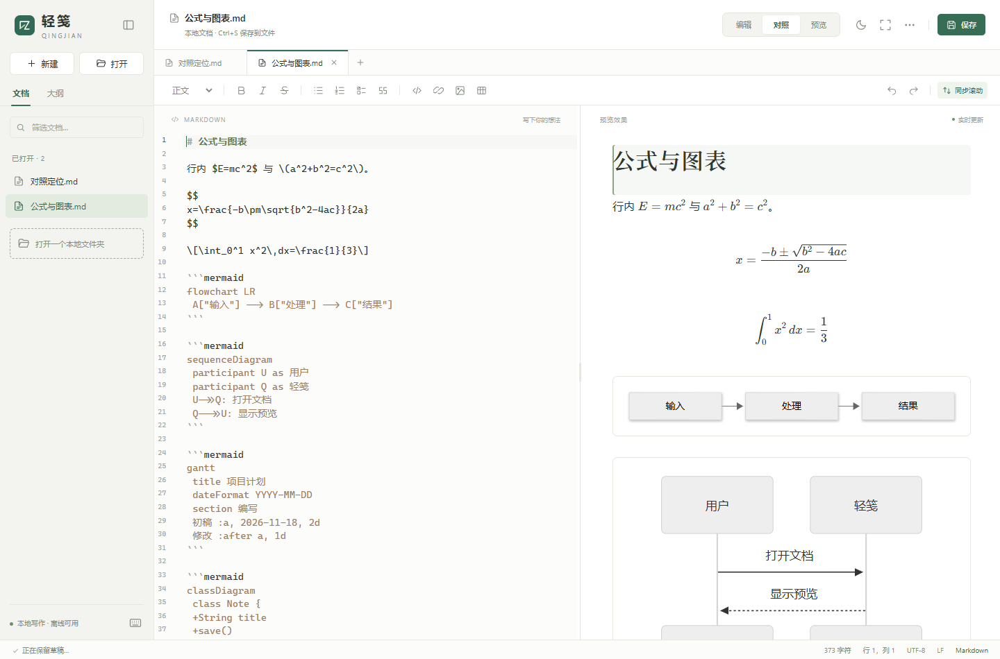

# 轻笺

一个离线的 Windows Markdown 编辑器，使用系统 WebView2、原生 WinForms 外壳和 CodeMirror 6。界面无需联网加载，发布包不包含 Node.js 或浏览器内核。当前版本 v0.2.0，完整程序文件约 7.8 MiB，不含系统运行时和个人缓存。

从 [Releases](https://github.com/ly2u/qingjian/releases/latest) 下载 Windows x64 压缩包，解压后双击 `轻笺.exe`。请保留整个文件夹。

支持编辑、对照、预览三种视图，多文档标签、同步滚动、双向定位高亮、文件夹列表、文档大纲、查找替换、常用格式工具、任务勾选、主题切换、草稿恢复、图片插入与 HTML / PDF 导出。详见 [使用说明](使用说明.txt)。



## 公式和图表

公式由 KaTeX 渲染，支持 `$…$` 行内公式、`$$…$$` 独立公式，以及 `\(…\)`、`\[…\]`。Mermaid 使用标记为 `mermaid` 的代码块，支持流程图、时序图、甘特图、类图等。两项功能均离线可用，仅在文档包含相应内容时加载。

[公式与图表示例](examples/公式与图表.md) 可直接在轻笺中打开。HTML 导出会嵌入公式字体与已渲染的图表；预览中的语法错误会保留原文并显示提示。

对照模式中，点击左侧会高亮右侧对应段落；点击右侧会定位并高亮左侧源码。表格按行、列表按条目对应，公式和图表按整块对应。

## Windows 文件关联

在程序的“更多选项 → Windows 文件关联”中选择“注册到打开方式”，再点“选择默认应用”。也可以双击程序目录中的 `注册到打开方式.cmd`，然后在 Windows 的“打开方式”里选择轻笺。

注册对当前用户生效，无需管理员权限。支持 `.md`、`.markdown`、`.mdown`，不修改其他编辑器的默认选择。已经打开轻笺时，再双击 Markdown 文件会交给现有窗口打开。

选择“移除系统注册”，或双击 `移除系统注册.cmd`，可清除轻笺创建的注册项。Windows 的“已安装的应用”中也有“轻笺（便携版系统注册）”移除入口。程序文件和个人数据会保留；如需删除程序，先移除注册，再删除程序文件夹。若轻笺曾是默认应用，移除后需重新选择打开方式。移动程序目录后请重新注册。

## 开发与构建

在 Windows 10/11 x64 上安装 Node.js 22 或更高版本。原生外壳使用系统 .NET Framework C# 编译器，不需要安装 Rust 或 .NET SDK。

```powershell
npm ci
npm test
npm run build
npm run test:browser
```

首次构建会从微软 NuGet 下载 WebView2 SDK。后续构建使用 `.build/webview2` 缓存。运行环境为 .NET Framework 4.7.2+ 和 WebView2 Evergreen Runtime。

```powershell
# 仅构建界面
npm run build:web
# 运行原生文件读写测试
powershell -NoProfile -ExecutionPolicy Bypass -File scripts/test-native.ps1
```

`src/` 为界面与编辑逻辑，`native/` 为文件和窗口操作，`tests/` 为数据与 Markdown 安全回归测试。`package-lock.json` 固定依赖版本，发布目录附带第三方许可文本。

草稿保存在 `%LOCALAPPDATA%\Qingjian\state.json`，另保留上一次成功写入的备份。通过同目录临时文件和原子替换保存文档；编码与换行方式随文件保留。预览 HTML 经过 DOMPurify 清理，页面通过受限消息桥请求原生操作。

本项目优先控制功能和分发体积，暂未加入插件、账户或云同步。KaTeX 支持常用 LaTeX 数学语法，不提供完整 LaTeX 文档编译。

## 许可与发布

沿用仓库的 Apache 2.0 许可证。发布目录附带第三方依赖的许可文本。推送 `v*` 标签后，GitHub Actions 会在 Windows 上构建、运行测试并上传 Release 压缩包与 SHA-256 校验文件。
