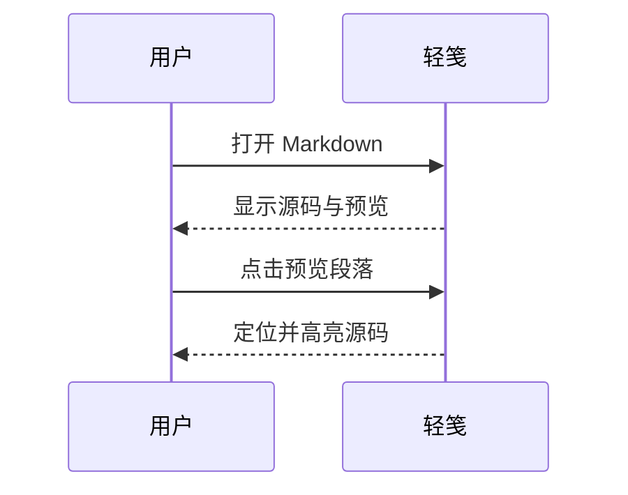
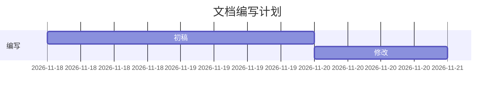

# 公式与图表

这份文档用于试写公式、图表和双向对照定位，全部内容都能离线显示。

## 数学公式

行内公式：$E=mc^2$，以及 \(a^2+b^2=c^2\)。

一元二次方程的求根公式：

$$
x=\frac{-b\pm\sqrt{b^2-4ac}}{2a}
$$

积分也可以这样写：

\[
\int_0^1 x^2\,dx=\frac{1}{3}
\]

## 流程图

## 时序图

## 甘特图

## 对照定位

点击这一段，左侧对应源码会高亮。再在左侧选择另一段，右侧也会标出相应位置。

| 项目 | 状态 |
| --- | --- |
| 行内公式 | 支持 |
| 独立公式 | 支持 |
| Mermaid 图表 | 支持 |

- [x] 试用公式
- [x] 试用图表
- [ ] 试用双向定位与任务勾选
